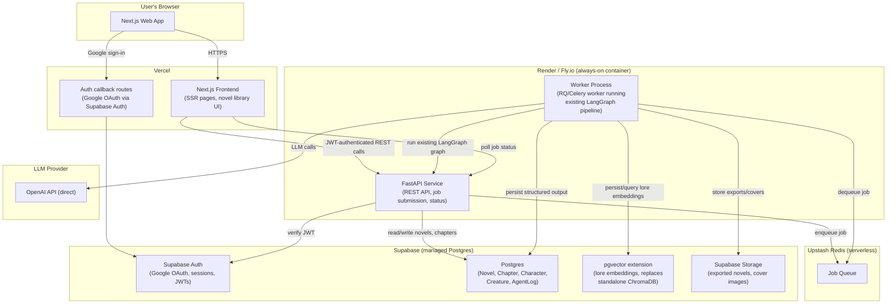
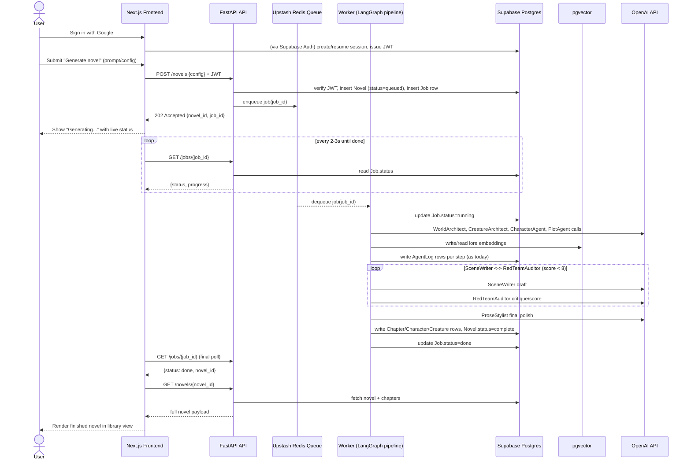
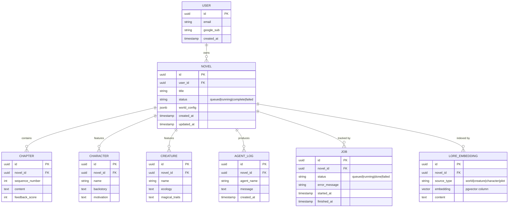
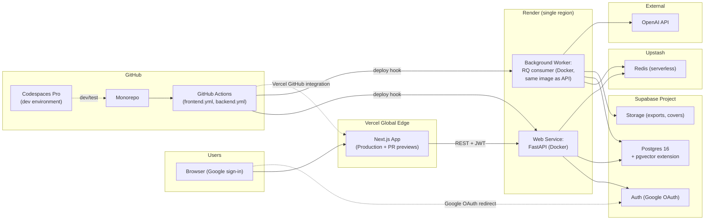

# Architecture Redesign Proposal: From Streamlit Prototype to a Persistent, Authenticated Web App

Status: **Proposal for validation — not implemented in this PR.**
Scope: Documentation only. No application code, infrastructure, or dependency changes are made alongside this document.

---

## 1. Executive Summary

NovelEngine today is a single-process Streamlit app: a LangGraph multi-agent
pipeline writes to a local SQLite database and a local ChromaDB vector store,
and a Streamlit UI polls that SQLite table to show live progress. This is
excellent for local development and demos, but it has three structural
problems once more than one person needs to use it:

1. **No persistence across deploys/restarts.** Streamlit Cloud (and most
   simple container hosts) give you ephemeral or single-instance disk.
   Every redeploy/restart can wipe `novelengine.db` and `chroma_db/`.
2. **No per-user identity.** Everyone sees the same SQLite rows; there is no
   concept of "my novels" vs. "someone else's novels."
3. **No async execution model.** Streamlit runs the LangGraph pipeline in a
   background thread inside the same process serving the UI. This doesn't
   survive a restart, doesn't scale past one user, and ties the life of a
   multi-minute job to the life of a single web request/session.

This document proposes a **value-for-money, validation-grade architecture**
that:

- Adds **Google Sign-In** so novels are owned by an authenticated user.
- Makes **all state durable** (relational data + lore vectors) in a managed
  database, independent of any app server's lifecycle.
- Replaces in-process background execution with an **async job model**:
  submit → queue → worker → poll/subscribe for status and result.
- **Keeps the existing Python/LangGraph/LangChain pipeline untouched**,
  wrapped behind a small FastAPI service instead of Streamlit's execution
  model.
- Fits a **~$20-50/month** budget, trading some scale/ops sophistication for
  low cost and low operational burden — appropriate for a prototype that
  needs to be validated with real users, not yet a production SLA product.
- Lives in a **single monorepo** with independently deployable frontend and
  backend pipelines.

This is a proposal only. Section 10 lays out a phased path to implement it,
and Section 11 lists open questions for you to weigh in on before any build
work starts.

---

## 2. Current State (What We're Moving Away From, and Why)

| Component | Current implementation | Problem for a validated, multi-user app |
|---|---|---|
| UI | Streamlit (`src/ui/app.py`), `st.fragment(run_every=2)` polling | Streamlit has no native multi-tenant auth/session-per-user model, and its background-thread execution pattern doesn't survive redeploys or scale across users. |
| Structured data | SQLite file (`novelengine.db`) locally, or RDS Postgres in the existing Terraform | SQLite file is not durable on most hosts (ephemeral filesystem); RDS is durable but is the expensive part of the stack we're simplifying. |
| Vector store | ChromaDB persisted to local disk / EFS | Needs a persistent volume wherever the backend runs; a separate stateful service to operate and back up. |
| Compute | ECS Fargate running the whole Streamlit container | Reasonable for production AWS shops, but Fargate + ALB + NAT gateway + RDS + EFS is overkill cost/ops for a validation prototype (realistically $150-300+/month once NAT gateway, ALB, and RDS are all running, even at the smallest reasonable sizes). |
| Auth | None | Hard requirement now (Google Sign-In). |
| Execution model | Synchronous-ish, in-process background thread, UI polls the same process's DB | No decoupling between "the thing generating the novel" and "the web server," so a multi-minute job is fragile and doesn't scale. |

**What we are deliberately leaving behind, and why:** the AWS
ECS Fargate + RDS + EFS Terraform in `infra/` was designed for a
"real" production deployment on AWS. For a validation prototype, it is the
single biggest source of both cost (ALB + NAT gateway + RDS + EFS all bill
whether or not anyone is using the app) and operational complexity (VPC
networking, IAM roles, Terraform state, task definitions). We are not
proposing to extend it — we're proposing to retire it in favor of a simpler
managed-service stack, and re-introduce AWS-grade infrastructure later only
if/when the product needs production SLAs, data residency requirements, or
scale that justifies the extra cost and ops burden.

---

## 3. Target Architecture Overview



**Key shift from today:** the frontend and the long-running generation job
are two different runtimes. The Next.js frontend only ever makes fast
request/response calls (submit job, poll status, fetch a finished novel).
All slow work happens in a worker process that is not tied to any single
HTTP request's lifetime.

---

## 4. Layer-by-Layer Comparison and Recommendations

### 4.1 Frontend hosting

| Option | Notes |
|---|---|
| **Vercel (Next.js)** — *recommended* | You already have a Vercel account/plan. Next.js on Vercel gives you SSR/ISR, built-in preview deployments per PR, and first-class support for Supabase Auth and Auth.js. Zero incremental cost beyond what you already pay. |
| Plain static SPA (Vite + React) on Vercel | Slightly simpler mental model, but you lose SSR (useful for an authenticated "my novels" page that should not flash unauthenticated content) and Vercel's Next.js-specific DX (image optimization, middleware for auth guards). |
| Netlify / Cloudflare Pages | Comparable capability, but you'd be paying for and learning a new platform instead of using the Vercel account you already have. |

**Recommendation:** Next.js on Vercel. **Sacrificed by not choosing it:**
nothing meaningful — this is the clear fit given existing tooling.

### 4.2 Backend/API hosting (FastAPI wrapper around the existing LangGraph pipeline)

The existing `src/agents/` LangGraph/LangChain pipeline is kept **as-is**.
We add a thin FastAPI layer (`backend/api/`) that exposes REST endpoints
(`POST /novels`, `GET /novels/{id}`, `GET /jobs/{id}`) and delegates the
actual multi-agent run to a worker process via a queue — the API layer
itself never runs the pipeline inline.

| Option | Fit for long-running LangGraph jobs | Cost | Notes |
|---|---|---|---|
| **Vercel Python serverless functions** | **Poor fit.** Even with Fluid compute, Hobby/Pro default execution time is 300s with an 800s (or 1800s beta, Pro+ with extra config) hard ceiling; cold starts and per-invocation billing also don't suit a process that needs to hold state across a multi-minute multi-agent loop. | Pay-per-invocation | Rejected for the actual generation job. Could still host the thin API routes, but see below for why colocating API+worker is simpler. |
| **Render** — *recommended* | Good. Render Web Service (always-on) for the API + a Render Background Worker (or second service) for the queue consumer; both run plain long-lived processes, no execution time ceiling. | Starter web service ~$7/mo, Starter worker ~$7/mo | Simplest GitHub-Actions-friendly deploy (git push / Docker image), native "Background Worker" service type is a direct match for our worker process, free TLS/custom domains, reasonable dashboard/logs. |
| Fly.io | Good — same long-running-process model, often marginally cheaper per instance (~$2-4/mo baseline for a small shared-cpu machine) but you manage more yourself (fly.toml, regions, scale-to-zero semantics, volumes) and its managed Postgres add-on is comparatively expensive if you were to use it (not needed here since we use Supabase for DB). | ~$3-5/mo per small machine | Good alternative if cost is the overriding factor and you're comfortable with its CLI-first workflow; slightly more ops overhead than Render for marginal savings at this scale. |
| Railway | Good, usage-based billing (RAM/CPU/time), $5/mo Hobby plan credit. | ~$5-15/mo at this scale | Comparable to Render; usage-based pricing is harder to predict month-to-month than Render's flat Starter tier. |
| Google Cloud Run | Good for the API (scales to zero, pay-per-request), but a background worker that must stay warm and hold an in-memory LangGraph run benefits more from an always-on process than Cloud Run's request-triggered model (workarounds exist — Cloud Run Jobs — but add complexity). | Pay-per-use, likely <$10/mo at low volume | Strong option if you want to stay in the AWS/GCP ecosystem conceptually, but adds a second cloud console/IAM model alongside Supabase/Vercel for comparatively little benefit at this scale. |
| AWS App Runner / ECS Fargate (existing Terraform) | Good execution fit (same as today), but highest cost/ops burden of all options (ALB, VPC/NAT if private subnets, IAM, Terraform state) for a prototype. | ~$60-150+/mo realistically once ALB/NAT are included | This is the "what we had" baseline — kept only as a documented fallback if the product later needs AWS-specific compliance/scale. |

**Recommendation:** **Render**, running two services from the same Docker
image/repo: a `web` service for the FastAPI API, and a `worker` (Background
Worker) service running the RQ/Celery consumer that executes the LangGraph
graph. **Sacrificed by not choosing it:** Fly.io's slightly lower raw compute
cost, and Cloud Run's scale-to-zero on the API tier — both minor at this
budget, and outweighed by Render's simpler GitHub-Actions deploy story and
native background-worker primitive.

### 4.3 Async job execution model (the core technical requirement)

Novel generation via the LangGraph pipeline can take minutes. The API must
never block an HTTP request on it.

```
Frontend → POST /novels (prompt/config)
API      → writes a `Job` row (status=queued) + Novel stub row in Postgres
API      → enqueues job id onto Redis queue
API      → returns 202 Accepted + job id immediately
Worker   → dequeues job id
Worker   → runs execute_graph() (existing, unchanged LangGraph pipeline)
Worker   → each agent node's writes go to Postgres (AgentLog) + pgvector, as today
Worker   → on completion, sets Job.status=done, Novel.status=complete
Frontend → polls GET /jobs/{id} every ~2-3s (same cadence as today's
           Streamlit fragment), or switches to Postgres LISTEN/NOTIFY +
           Supabase Realtime subscription later if polling proves too chatty
```

| Option | Notes |
|---|---|
| **Upstash Redis + RQ (Python)** — *recommended* | RQ is simple, pure-Python, fits a single worker process well, and Upstash gives a fully managed, serverless-billed Redis with a generous free tier (500k commands/mo) and cheap fixed plans ($10/mo) beyond that — no Redis server to operate. |
| Redis + Celery | Celery is more powerful (retries, chains, scheduling) but meaningfully more operational complexity (broker + result backend config, worker concurrency tuning) than this prototype needs. Worth revisiting if we later need multi-step job pipelines with retries/backoff policies beyond what RQ offers. |
| Platform-native background jobs (e.g., Render Cron Jobs / Jobs) | Fine for scheduled/batch work, not designed for "submit one ad-hoc job per user action and track its status" — would require bolting our own queue semantics on top anyway. |
| Postgres-as-a-queue (`SKIP LOCKED` table) | Removes the Redis dependency entirely (one less moving part), works fine at this scale. Viable alternative if you'd rather not add Upstash at all — trades a small amount of code (polling/locking logic) for one fewer managed service. |

**Recommendation:** Upstash Redis + RQ, with the worker as a second Render
service consuming the same codebase. **Sacrificed by not choosing it:**
Celery's richer workflow features (not needed yet), and the small simplicity
of a Postgres-queue (traded for RQ's more battle-tested job/retry/timeout
semantics out of the box).

### 4.4 Authentication (Google Sign-In)

| Option | Google sign-in | Session mgmt | Bundles with DB? | Notes |
|---|---|---|---|---|
| **Supabase Auth** — *recommended* | Yes, first-class Google OAuth provider config (few clicks in dashboard + Google Cloud OAuth client). | Issues JWTs, has SSR helpers for Next.js (`@supabase/ssr`), refresh-token handling built in. | **Yes** — same Supabase project as your Postgres DB; `auth.users` sits in the same instance you're already paying for. | Lowest total integration work since DB + auth + vector store all live in one service/bill. |
| Auth.js (NextAuth) | Yes, well-supported Google provider. | Good, but you own the session storage adapter (e.g., Postgres adapter) and more wiring to connect it to backend JWT verification for the separate FastAPI service. | No — you'd wire it to whichever Postgres you choose. | More flexible/portable, but more integration code to verify sessions from the Python backend. |
| Clerk | Yes, polished UI components, very easy Google sign-in. | Excellent, managed. | No — separate billing, separate identity store to sync with your DB's user table. | Clerk's free tier is generous but becomes a 4th paid vendor at scale; nice DX, but redundant given Supabase already covers this. |
| Firebase Auth | Yes. | Good, but pulls in the Firebase/GCP ecosystem and a different SDK/console than everything else here. | No — yet another service to wire to Postgres. | Only compelling if you were already deep in Firebase; not the case here. |

**Recommendation:** Supabase Auth. **Sacrificed by not choosing it:**
Clerk's more polished pre-built auth UI components (Supabase's are good but
more DIY), and Auth.js's framework-native feel if you want everything to
live purely in Next.js config. Both are reasonable fallbacks if Supabase's
auth customization proves limiting later.

### 4.5 Relational database (structured data: Novel, Chapter, Character, Creature, AgentLog)

| Option | Notes |
|---|---|
| **Supabase Postgres** — *recommended* | Standard Postgres (SQLAlchemy 2.0 models need no rewrite, just a new connection string), bundles with Auth above, supports the `pgvector` extension (see 4.6), has a usable free tier for dev and a $25/mo Pro tier with always-on compute + daily backups for the validation deployment. |
| Neon | Excellent serverless Postgres (scale-to-zero branches are great for CI/preview envs), but auth would then be a separate vendor (Auth.js/Clerk), adding integration work without a clear cost/benefit win here. |
| Railway Postgres | Simple, usage-based, but again a separate identity provider needed; also less generous backup/PITR story than Supabase Pro. |
| AWS RDS (existing) | Most mature/production-grade option, but the most expensive and highest-ops of this set (own the instance sizing, patching cadence awareness, VPC networking) — this is the piece we are explicitly replacing. |
| PlanetScale (MySQL) | Would require switching the ORM dialect away from Postgres/SQLite-compatible SQL and lose `pgvector` entirely — not a fit given the vector-store consolidation goal below. |

**Recommendation:** Supabase Postgres (same project as Auth).
**Sacrificed by not choosing it:** Neon's serverless branch-per-PR workflow
(a nice-to-have for CI, not essential at this stage), and RDS's AWS-native
IAM/network isolation story (not needed for a validation prototype).

### 4.6 Vector store for lore retrieval (currently ChromaDB)

| Option | Notes |
|---|---|
| **pgvector on the same Supabase Postgres** — *recommended* | Consolidates a 3rd stateful service (Chroma + its persistent volume) into infrastructure you already have. LangChain has a maintained `PGVector` vectorstore integration, so the swap is a store-adapter change, not a pipeline rewrite — `src/db/vector_store.py` gets a new backend implementation behind the same interface. At our current lore-embedding volume (world lore, creatures, characters, plot beats per novel — thousands, not millions, of vectors), pgvector's performance is more than sufficient. |
| Keep self-hosted Chroma | Would need a persistent volume attached to whichever backend host we pick (Render/Fly.io both support attached disks for this), plus Chroma's own container to run and back up — a 3rd stateful service for no added capability at this scale. Rejected primarily on ops-consolidation grounds, not performance. |
| Pinecone | Purpose-built, scales further than we need, but is a 4th paid vendor and introduces a service with no overlap with anything else we're using. |
| Qdrant Cloud | Similar tradeoff to Pinecone — excellent product, but unnecessary extra vendor/cost for this scale of lore corpus. |
| Supabase Vector (their pgvector-based offering) | This is effectively the same as "pgvector on Supabase Postgres" above, just Supabase's branded product name for it — recommendation above already captures this. |

**Recommendation:** pgvector inside the same Supabase Postgres instance used
for structured data. **Sacrificed by not choosing it:** Chroma's slightly
simpler local-dev story (it's what's used today, and genuinely easier to run
with zero config locally) and Pinecone/Qdrant's purpose-built vector-search
performance headroom — not needed at current/expected corpus size, and
consolidating onto Postgres removes an entire service from the ops surface.

### 4.7 File/object storage

| Option | Notes |
|---|---|
| **Supabase Storage** — *recommended* | Needed for exported novel files (e.g., EPUB/PDF/Markdown export) and any generated cover art. Included in the Supabase project you're already paying for (1 GB free, cheap per-GB beyond that), with Row Level Security so a user can only access their own files. |
| Vercel Blob | Reasonable if you wanted to keep storage entirely on the Vercel side; adds a 4th billing surface for something Supabase already covers. |
| AWS S3 | Most standard/portable option, but introduces an AWS account/IAM surface purely for file storage when Supabase Storage already satisfies the need. |

**Recommendation:** Supabase Storage. **Sacrificed by not choosing it:**
S3's broader ecosystem/tooling maturity — not needed at this scale.

### 4.8 LLM provider: direct OpenAI vs. OpenRouter

| Option | Notes |
|---|---|
| **Direct OpenAI (keep current setup)** — *recommended for now* | OpenRouter's pricing is pass-through (no markup on provider rates), so there's no cost saving for a single-provider workload today; it adds ~100-150ms of routing latency and an extra account/API-key surface for no immediate benefit since the pipeline currently only targets OpenAI models. |
| OpenRouter as a fronting layer | Becomes valuable the moment you want: (a) automatic fallback if OpenAI has an outage/rate-limits you mid-generation (meaningful for a multi-minute, multi-agent run where a single failed call currently fails the whole job), or (b) easy A/B testing of cheaper/faster models per agent node (e.g., a cheaper model for `RedTeamAuditor` critique vs. a stronger one for `SceneWriter` prose) without managing multiple provider SDKs/keys. OpenRouter exposes an OpenAI-compatible API, so this is a low-effort swap later (change `base_url` + API key) if either benefit becomes a priority. |

**Recommendation:** Keep calling OpenAI directly for the initial validation
deployment. **Revisit OpenRouter** specifically if you start seeing OpenAI
rate-limit/availability issues during multi-agent runs, or want to
cost/quality-tune individual agent nodes against different models —
document this as a near-term enhancement, not part of this redesign's
Phase 1-3 (Section 10).

### 4.9 CI/CD and development environment

- **GitHub Actions**, two independent workflows in the monorepo (Section 5):
  - `frontend.yml` — lint/build/test the Next.js app; Vercel's GitHub
    integration handles the actual deploy on push (preview deploys per PR,
    production deploy on merge to `main`).
  - `backend.yml` — lint/test the FastAPI + existing `src/agents` pipeline
    (reusing the existing `pytest tests/` suite), build and push the backend
    Docker image, then trigger a Render deploy (via Render's deploy hook URL
    or the `render-actions` GitHub Action).
- **GitHub Codespaces Pro** is used for development: a `.devcontainer`
  (built from the existing `Dockerfile` as a base) gives contributors a
  one-click environment with Python 3.11, the dependencies in
  `requirements.txt`, and Node.js for the frontend — no local setup required,
  and Codespaces Pro's larger machine types comfortably handle running both
  the Next.js dev server and the FastAPI/worker processes side by side for
  local full-stack testing before pushing.

---

## 5. Repo Structure (Single Monorepo)

```
fantasy-novel-generator/
├── frontend/                      # Next.js app (deployed to Vercel)
│   ├── app/                       # Next.js App Router pages
│   │   ├── (auth)/                # Google sign-in / callback routes
│   │   ├── novels/                # "My novels" library + detail views
│   │   └── layout.tsx
│   ├── lib/
│   │   ├── supabaseClient.ts      # Supabase Auth/session helpers
│   │   └── api.ts                 # Typed client for backend REST API
│   ├── package.json
│   ├── vercel.json
│   └── ...
│
├── backend/                        # FastAPI + existing agent pipeline
│   ├── api/
│   │   ├── main.py                # FastAPI app, routes: /novels, /jobs
│   │   ├── auth.py                 # Supabase JWT verification middleware
│   │   └── schemas.py              # Pydantic request/response models
│   ├── worker/
│   │   ├── run_worker.py           # RQ worker entrypoint
│   │   └── tasks.py                # enqueue/execute_graph() glue
│   ├── src/                        # EXISTING pipeline, unchanged in place
│   │   ├── agents/                 # graph.py, state.py, nodes/ (as today)
│   │   ├── db/                     # models.py, vector_store.py
│   │   │                            #   (vector_store.py gains a pgvector
│   │   │                            #    backend behind the same interface)
│   │   └── ui/                     # legacy Streamlit UI kept for now,
│   │                                #   or removed once frontend replaces it
│   ├── tests/                      # existing pytest suite, unchanged
│   ├── Dockerfile                  # backend-only image (API + worker)
│   └── requirements.txt
│
├── infra/
│   ├── supabase/                   # SQL migrations (tables, pgvector ext,
│   │                                #   RLS policies) — supabase CLI managed
│   └── aws-legacy/                 # existing Terraform (ecs.tf, rds.tf,
│                                     #   efs.tf, etc.) kept for reference /
│                                     #   future production use, not deployed
│
├── docs/
│   └── architecture-redesign.md    # this document
│
├── .github/
│   └── workflows/
│       ├── frontend.yml            # lint/build/test frontend; Vercel
│       │                            #   handles actual deploy via its
│       │                            #   GitHub App integration
│       └── backend.yml             # lint/test backend (pytest), build +
│                                     #   push Docker image, trigger Render
│                                     #   deploy hook
│
├── .devcontainer/                  # Codespaces config for full-stack dev
├── README.md
└── product_backlog.md
```

This keeps the existing `src/agents` and `src/db` packages intact (moved
under `backend/src/` with no internal changes expected beyond the storage
backend swap), so the multi-agent pipeline itself is untouched — only how it
is invoked (worker task vs. Streamlit background thread) and how it persists
data (Supabase Postgres/pgvector vs. local SQLite/Chroma) change.

---

## 6. Sequence Diagram: Novel Generation Job



---

## 7. Data Model / ER Diagram



This is a direct evolution of the existing SQLAlchemy models
(`src/db/models.py`): we add `USER` (populated by Supabase Auth) and `JOB`
(new, for the async execution model), add a `user_id` foreign key to
`NOVEL` for ownership/row-level security, and replace ChromaDB's separate
collection storage with a `LORE_EMBEDDING` table using pgvector's `vector`
column type — `AgentLog`, `Chapter`, `Character`, and `Creature` keep their
existing shape.

---

## 8. Deployment Topology



---

## 9. Rough Monthly Cost Estimate

| Service | Tier | Est. monthly cost |
|---|---|---|
| Vercel | Existing plan (assume Hobby/Pro you already have) | $0 incremental |
| Render — Web Service (API) | Starter | ~$7 |
| Render — Background Worker | Starter | ~$7 |
| Supabase | Pro (Postgres + Auth + Storage + pgvector, always-on, daily backups) | $25 |
| Upstash Redis | Free tier (500k commands/mo) initially, Fixed 250MB plan if needed | $0-$10 |
| OpenAI API | Usage-based (unchanged from today) | variable, not part of infra cost |
| GitHub Codespaces Pro | Already owned | $0 incremental |
| **Total infra (excl. LLM usage)** | | **~$39-49/month** |

This sits within the confirmed $20-50/mo budget. If validation goes well and
usage grows, the first upgrade pressure points will be Supabase compute size
and Render instance size — both scale incrementally rather than requiring an
architecture change.

**For comparison, the retired AWS stack** (ALB + NAT Gateway + ECS Fargate
task + RDS db.t4g.micro + EFS), run continuously, realistically lands around
**$150-250+/month** even at the smallest reasonable sizes — the NAT Gateway
and ALB hourly charges alone are typically $35-50/month combined, before any
compute or storage.

---

## 10. Phased Migration Plan (Proposal Level Only)

> No implementation happens as part of this document — this is a high-level
> sequencing proposal for a future build phase.

**Phase 1 — Auth + Persistence**
Stand up the Supabase project (Auth with Google OAuth, Postgres schema
migrated from `src/db/models.py`, pgvector extension enabled). Build the
Next.js frontend's sign-in flow and a minimal "my novels" list backed
directly by Postgres (no job queue yet — can initially call the existing
pipeline synchronously behind FastAPI for a single small test novel, purely
to validate the auth + persistence wiring end-to-end).

**Phase 2 — Async Job Pipeline**
Introduce Upstash Redis + RQ, split the backend into API + worker services
on Render, move the LangGraph execution fully into the worker, add the
`Job` table and status-polling endpoints, and update the frontend to submit
a job and poll for completion instead of waiting on a synchronous request.
Swap `src/db/vector_store.py`'s ChromaDB backend for a pgvector-backed
implementation behind the same interface.

**Phase 3 — Polish**
Add novel export (PDF/EPUB/Markdown) to Supabase Storage, cover image
generation/storage, nicer live-progress UI (consider swapping polling for
Supabase Realtime subscriptions on the `Job`/`AgentLog` tables), basic
observability (error reporting, job retry/backoff tuning), and decide
whether/when to retire the legacy Streamlit UI entirely.

---

## 11. Open Questions

1. **Realtime vs. polling:** Are you OK starting with simple HTTP polling
   for job status (matching today's 2-second Streamlit cadence), with
   Supabase Realtime/websockets as a Phase 3 enhancement rather than a
   Phase 1 requirement?
2. **Legacy Streamlit UI:** Should the existing Streamlit app be kept
   running (e.g., as an internal/admin tool) after the Next.js frontend
   ships, or fully retired once the new UI reaches parity?
3. **Export formats:** Do you have a specific priority order for novel
   export formats (Markdown, PDF, EPUB), or should Phase 3 start with
   plain Markdown/HTML export and add others based on validation feedback?
